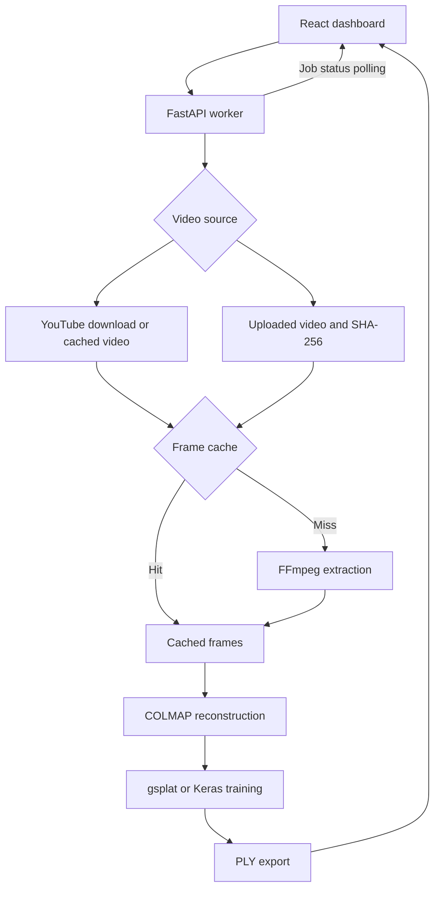

# YouTube Splat AI

Video-to-3D Gaussian Splat reconstruction studio with a React/Vite dashboard, FastAPI GPU worker, FFmpeg, COLMAP, Nerfstudio Splatfacto and an experimental TensorFlow/Keras renderer.

**Hosted frontend:** [youtube-splat-ai.vercel.app](https://youtube-splat-ai.vercel.app) — requires a separately running HTTPS GPU worker. For local GPU processing, run both services locally.

## Features

- YouTube URL ingestion and device video uploads (MP4, MOV, AVI, WEBM, MKV, M4V; maximum 500 MiB).
- Persistent video and frame caching across reconstruction attempts.
- Camera pose estimation with COLMAP, including optional CPU preprocessing.
- Splatfacto/gsplat training and experimental Keras training.
- Overall stage indicator, measured frame and iteration counters, cache notifications and error logs.
- Interactive Gaussian Splat viewer and PLY download.
- Local Docker Compose mode and Vercel frontend deployment.

## Architecture



## Quick start — Windows WSL2 or Linux

Requirements: Git, Docker Compose, compatible NVIDIA GPU and driver, Docker Desktop with WSL2 GPU support on Windows or NVIDIA Container Toolkit on Linux.

```powershell
git clone https://github.com/AlexSmiley/youtube-splat-ai.git
cd youtube-splat-ai
docker compose build worker
docker compose up --no-build
```

Open [http://localhost:5173](http://localhost:5173), select **Use local backend**, then **Test connection**. Both services bind to loopback only.

| Service | URL |
| --- | --- |
| Local frontend | http://localhost:5173 |
| Backend | http://localhost:8000 |
| Health check | http://localhost:8000/health |
| Swagger | http://localhost:8000/docs |

To update an existing checkout (stop active jobs first):

```powershell
git pull origin main
docker compose up -d --no-build
docker compose restart worker
```

To stop: `docker compose down`. Data persists in `./data`.

### Optional Keras engine

PowerShell:

```powershell
$env:INSTALL_KERAS="true"
docker compose up --build
```

On Linux: `INSTALL_KERAS=true docker compose up --build`. TensorFlow and PyTorch CUDA dependencies may require separate environments if conflicts arise. The experimental renderer uses 512 or fewer isotropic Gaussians and 48×48 images; it is not equivalent to full 3DGS.

### Manual startup

In a prepared Python 3.10 GPU environment with project dependencies, FFmpeg and COLMAP installed:

```bash
python -m uvicorn backend.main:app --host 127.0.0.1 --port 8000
```

In another terminal:

```bash
cd frontend
npm install
npm run dev -- --strictPort
```

## Usage

1. Connect to the worker and test its health.
2. Select YouTube URL or Upload from device. Only process authorized videos.
3. Select the engine and quality.
4. Confirm permission and generate.
5. Monitor progress and logs, then view or download the resulting PLY.

Default example: https://www.youtube.com/watch?v=oxxucX4dr5k (not a verified reconstruction).

| Quality | Target frames | Training iterations |
| --- | ---: | ---: |
| Fast | 100 | 3000 |
| Balanced | 200 | 7000 |
| High | 400 | 30000 |

## Live progress

The dashboard polls every two seconds. Overall progress is a stage estimate, not elapsed time. FFmpeg machine-readable counters drive the frame extraction bar; completed extraction may yield fewer frames than requested. Cached frames are immediately complete. Training counters use recognized Nerfstudio console iteration lines or explicit Keras iteration logs. Unrecognized Nerfstudio output may leave the counter unchanged until training finishes. Failed stages retain their last non-empty log and show errors.

## Persistent cache

| Scenario | Download | Frame extraction |
| --- | --- | --- |
| New YouTube ID | Required | Required |
| Same ID and frame count | Reused | Reused |
| Different engine or iterations | Reused | Reused |
| Different frame count | Reused | Required |
| Identical uploaded bytes and frame count | Not applicable | Reused |

Uploads are identified by SHA-256 and still need to be transmitted. Completed frames survive COLMAP failures. Reconstruction and training run for every new job. Cache entries are published after successful extraction. Pre-cache jobs are not imported automatically; no automatic eviction is implemented.

```text
data/
  cache/
    youtube-VIDEO_ID/
      video.mp4
      video.json
      frames-v1-200/
    upload-SHA256/
      frames-v1-200/
  JOB_ID/
    scene/
    runs/
    export/
    state.json
    training.log
```

Stop the worker before deleting `data/cache` to reclaim disk space or force fresh downloads.

## API

| Method | Endpoint | Purpose |
| --- | --- | --- |
| GET | /health | API availability |
| POST | /jobs | JSON: url, engine, frames, iterations |
| POST | /jobs/upload | Multipart: video, engine, frames, iterations |
| GET | /jobs/{id} | Status, stage, logs, progress and model URL |
| GET | /models/{id}/export/{filename} | Exported PLY |

Progress fields: `frames_done`, `frames_total`, `frames_complete`, `training_done`, `training_total`, `download_cached`, `frames_cached`. Cache flags may be absent on misses. Job creation returns HTTP 202 with an ID. Jobs are serialized in a single process; do not run multiple Uvicorn workers.

## Vercel and cloud GPU

Configure Vercel with root directory `frontend`, Vite framework, build command `npm run build`, output `dist`. Set `VITE_API_URL` to the HTTPS worker endpoint or enter it in the dashboard. Rebuild after changing build-time variables.

Deploy the GPU Docker image separately with persistent /data and an authenticated HTTPS reverse proxy. Set `ORIGINS` to the exact allowed frontend origins, e.g. `https://youtube-splat-ai.vercel.app`. Configure upload limits and authentication. Do not deploy the GPU training worker as a Vercel function. Production frontend does not default to localhost; use local mode for local HTTP access. No cloud GPU resources are provisioned by this repository.

## Troubleshooting

### COLMAP Qt / xcb errors

The Docker image isolates COLMAP from OpenCV Qt plugins and selects offscreen Qt.

```powershell
docker compose build --no-cache worker
docker compose up -d worker
```

If GPU SIFT or OpenGL still fails, enable CPU COLMAP preprocessing:

```powershell
$env:COLMAP_CPU="true"
docker compose up -d --force-recreate worker
```

This does not remove the CUDA requirement for gsplat training. Submit a new job; failed jobs do not resume automatically.

### GPU and logs

```powershell
docker compose exec worker nvidia-smi
docker compose exec worker python3 -c "import torch; print(torch.cuda.is_available())"
docker compose logs -f worker
Get-Content .\data\JOB_ID\training.log -Tail 100
```

Replace JOB_ID with the actual job ID. For connection errors, check /health, the frontend origin and backend URL. COLMAP needs overlapping views of a mostly static scene; YouTube access may fail due to platform restrictions.

## Tests and limitations

```bash
python -m pytest -q
python -m compileall backend
cd frontend
npm install
npm run build
```

URL validation and mocked upload tests are included. Full GPU reconstruction, recent Docker changes, progress parsing against real training output and browser rendering require integration verification. Only PLY export is implemented. Authentication, quotas, cancellation, restart recovery, durable queues and production hardening are not implemented. Do not expose the unauthenticated API publicly.

## Reuse the GPU environment
The local worker image is named `youtube-splat-worker:local`. Build it once successfully with `docker compose build worker`. Subsequent launches use `docker compose up -d --no-build`. Backend source is bind-mounted read-only; after git pull, restart the worker without rebuilding. Rebuild only for Dockerfile or dependency changes. Failed builds cannot reuse incomplete installation layers. Inspect storage with `docker system df -v`; avoid routine cache pruning because it removes reusable layers. Never delete ./data to clean Docker cache. Docker Desktop virtual disk space may need separate reclamation. Stop active jobs before restarting.
